<div align="center">




</div>

<br/>

<div align="center">

</div>

<br/>

## 🧑‍💻 About Me

```yaml
whoami:     R3dh47
role:       Full Stack Developer (in progress) x Cybersecurity Student
education:  B.Sc. Cybersecurity - 1st Year
focus:      [Web Development, Networking, Ethical Hacking]
learning:   [C, JavaScript, Linux, Web Security, APK Development]
ask_me:     Networking
contact:    r3dhat404@gmail.com
motto:      "Build secure. Break ethically. Ship fast."
```

<div align="center">

<a href="mailto:r3dhat404@gmail.com"></a>
<!-- Uncomment and edit these once ready:
<a href="https://www.linkedin.com/in/YOUR-USERNAME" target="_blank"></a>
<a href="https://YOUR-PORTFOLIO.com" target="_blank"></a>
-->

</div>

<br/>

## 🧭 What I Do

- 💻 **Build** - responsive web apps and admin dashboards in JavaScript (see projects below)
- 🔐 **Secure** - learning networking, Linux and web-app security in legal lab environments
- 🎯 **Goal** - more full-stack projects + hands-on security practice (CTFs, labs)

<br/>

## 🛠️ Tech Stack

<div align="center">


</div>

<br/>

## 📊 GitHub Analytics

<div align="center">


</div>

<br/>

## 🚀 Featured Projects

<div align="center">

<table>
<tr>
<td width="50%">
<a href="https://github.com/r3dh47-ui/civic-app">

</a>
</td>
<td width="50%">
<a href="https://github.com/r3dh47-ui/RIMT-BCA-APP">

</a>
</td>
</tr>
<tr>
<td width="50%">
<a href="https://github.com/r3dh47-ui/rimt-admin-portal">

</a>
</td>
<td width="50%">
<a href="https://github.com/r3dh47-ui/FRONTEND-RIMT-APP">

</a>
</td>
</tr>
</table>

</div>

<br/>

<div align="center">



</div>
